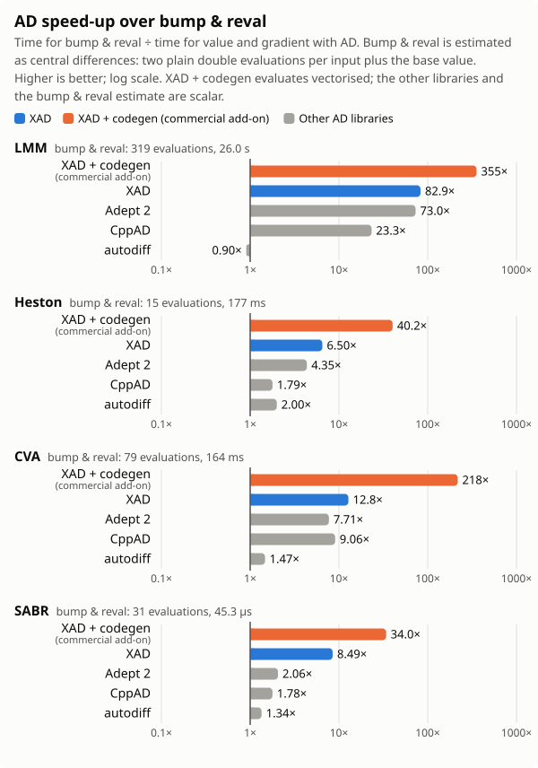

# AD Library Benchmarks

Benchmarks of C++ automatic differentiation (AD) libraries on four quantitative-finance workloads. Every workload is
written once as a template on the number type and run unchanged with plain `double`, finite differences and each AD
library, in the same build and on the same machine. The suite is maintained by the XAD team at Xcelerit; every
library is used the way its authors document, and corrections are welcome (see [Contributing](#contributing)).

## Workloads

| | Workload | What is differentiated | Published size |
|---|---|---|---|
| W1 | LMM: swaption portfolio under a one-factor LIBOR market model (Giles and Glasserman, "Smoking Adjoints") | price with respect to 159 inputs (80 initial forwards, 79 volatilities) | 10,000 paths |
| W2 | Heston: Monte Carlo pricing of an option book (calls, puts, Asian calls), full-truncation Euler | book value with respect to the 7 model and market inputs | 10,000 paths, 100 steps |
| W3 | CVA on a swap portfolio under a correlated multi-factor Gaussian short-rate model | CVA with respect to its 39 inputs (curve, model, credit and trade parameters) | 20 swaps up to 10 years, 500 paths |
| W4 | SABR: calibration residuals of a smile surface | the full 100 x 15 Jacobian of the residuals | 100 quotes |

Source comments use the IDs W1–W4 from this table.

## Libraries

| Library | Version | How it is used |
|---|---|---|
| [XAD](https://github.com/auto-differentiation/xad) | v2.2.0 | operator overloading, tape recorded on every evaluation (SABR: forward mode) |
| [Adept 2](https://github.com/rjhogan/Adept-2) | v2.1.3 | operator overloading, tape recorded on every evaluation; built with its thread-unsafe stack |
| [CppAD](https://github.com/coin-or/CppAD) | 20250000.2 | tape recorded once in untimed set-up (path inputs as dynamic parameters, `optimize()` applied), then replayed |
| [autodiff](https://github.com/autodiff/autodiff) | v1.1.2 | forward mode (dual numbers), one pass per input; its reverse mode does not suit these kernels (see the comments in `workloads/{lmm,heston,cva}/autodiff.hpp`); one pass per input is the same order of cost as bump & reval, so its speed-ups are at most about 2× (below 1× on LMM) |
| XAD + codegen | commercial, not in this repository | commercial add-on to XAD from [Xcelerit](https://www.xcelerit.com/xad/#editions); results only, see below |

Every library is fetched at configure time from a pinned commit archive checked against its SHA-256
(`cmake/deps.cmake`).

xad-codegen is a commercial add-on to XAD that compiles a recorded tape to native code and evaluates it vectorised
across Monte Carlo paths or quotes; in this run it used the widest vector instructions the CPU supports. It records
and compiles once in untimed set-up, so its times cover evaluation only. It is not part of this repository and its
results cannot be reproduced from it. xad-codegen is available from Xcelerit with XAD commercial licences; to have
it measured on your own code, see the [XAD editions](https://www.xcelerit.com/xad/#editions).

## Results

How much faster each library computes the value and its gradient (SABR: Jacobian) than bump & reval, the finite
differences that AD replaces. Bump & reval is estimated as central differences: two plain `double` evaluations per input
plus the base value (LMM 319, Heston 15, CVA 79, SABR 31). Higher is better. XAD + codegen evaluates vectorised; the other libraries and the bump & reval estimate are scalar.

<picture>
  <source media="(prefers-color-scheme: dark)" srcset="results/amd/speedup-dark.svg">
  
</picture>

Of the open-source libraries, XAD is the fastest on all four workloads; the commercial XAD + codegen add-on is faster
than plain `double` on all four.

Median time per evaluation of the value and its gradient (SABR: Jacobian), and in brackets the overhead over plain
`double`: the time divided by that of "double (no AD)", the plain evaluation of the same workload without derivatives
(1.00×). Lower is better. XAD + codegen is below 1× on all four workloads: it is faster than the plain scalar
`double` code, since the add-on evaluates vectorised.

<!-- results:begin -->
| Library | LMM<br>price + 159 sensitivities | Heston<br>book value + 7 sensitivities | CVA<br>CVA + 39 sensitivities | SABR<br>100 residuals + 1,500 sensitivities |
|---|---:|---:|---:|---:|
| double (no AD) | 81.4 ms (1.00×) | 11.8 ms (1.00×) | 2.08 ms (1.00×) | 1.46 µs (1.00×) |
| XAD + codegen (commercial add-on) | 73.2 ms (0.90×) | 4.39 ms (0.37×) | 753 µs (0.36×) | 1.33 µs (0.91×) |
| XAD | 313 ms (3.85×) | 27.2 ms (2.31×) | 12.8 ms (6.18×) | 5.33 µs (3.65×) |
| Adept 2 | 356 ms (4.37×) | 40.5 ms (3.45×) | 21.3 ms (10.2×) | 22.0 µs (15.1×) |
| CppAD | 1.11 s (13.7×) | 98.8 ms (8.40×) | 18.1 ms (8.72×) | 25.4 µs (17.4×) |
| autodiff | 28.7 s (353×) | 88.5 ms (7.52×) | 112 ms (53.7×) | 33.7 µs (23.1×) |
<!-- results:end -->

Table and chart are generated by `scripts/results_table.py` and `scripts/chart.py` from
`results/amd/<workload>.csv`; the per-round CSVs are in `results/amd/round_<k>/`. In the combined CSVs, `median_s`,
`iqr_s` (interquartile range of the timed iterations) and `ratio` (time relative to plain `double`) are medians over
the rounds, and the memory columns the maximum. The table divides the combined `median_s` by plain's, so it can differ
slightly from the `ratio` column, a median of per-round ratios; the chart divides (2 × inputs + 1) × plain's combined
`median_s` by each library's.

Run on 10 November 2026:

- CPU: AMD EPYC, Zen 5 (Turin). All runs single-threaded on one pinned core.
- OS: Linux 7.0 (Ubuntu), transparent huge pages `madvise`.
- Compiler: GCC 15.2, `-O3` (CMake Release), `-march=native -ffp-contract=off` for the suite and every library, link-time
  optimisation on (for everything but the separately built CppAD library).
- XAD: v2.2.0, built with `XAD_USE_STRONG_INLINE`, `XAD_NO_THREADLOCAL` and `XAD_LINEAR_SLOTS` on and
  `XAD_POSITION_INDEPENDENT_CODE` off (the `published` preset). These options were chosen from a sweep of nine XAD option sets in an earlier run; the
  results above come from a separate run.
- XAD + codegen: a separate build with the same XAD version and options, plus the add-on.

## Methodology

- Every library is used through its own documented API, with the same compiler, instruction set and floating-point
  flags. XAD's build options were chosen from a sweep of nine option sets; the other libraries use their documented
  defaults, apart from Adept's thread-unsafe stack. Maintainers who know faster settings are welcome to send them.
- Timed regions differ by design: XAD and Adept record their tape inside the timed region (on SABR, XAD runs forward
  mode and records nothing); CppAD and XAD + codegen record (and the add-on generates and compiles) once in untimed
  set-up, so their times cover evaluation only.
- Each benchmark program runs warm-up iterations, then reports the median over its timed iterations (LMM 10, Heston 20,
  CVA 20, SABR 2,000). The run was repeated in 3 rounds, each starting at a different workload, and the published
  figure is the median of the 3 round medians.
- Before timing, the full gradient (SABR: Jacobian) of every library was computed at the published size and compared
  with XAD's at its default options: all agreed within a relative tolerance of 1e-10 (absolute floor 1e-22). The test suite checks gradients at
  smaller sizes (XAD against finite differences, every other library against XAD).

## Build and test

Needs CMake 3.20 or later, a C++17 compiler, Ninja and Python 3 (pytest for the script tests). The workflow-file
tests (label `lint`) also need actionlint and PyYAML at configure time; without them they are not registered.

```bash
cmake -S . -B build -G Ninja -DCMAKE_BUILD_TYPE=Release
cmake --build build --parallel
ctest --test-dir build -L "unit|check|lint" --output-on-failure
```

The default target is `-march=x86-64-v3`, a portable x86-64 level; `-DADB_ARCH_FLAGS=...` changes it for every
library at once. The build options of the published run are the `published` preset in `CMakePresets.json`:

```bash
cmake --preset published
cmake --build build --parallel
```

Another XAD commit is selected with `-DADB_XAD_COMMIT=<sha> -DADB_XAD_SHA256=<archive sha256>`.

## Run

```bash
export BENCH_LMM_ARGS="--paths 10000 --warmup 2 --iters 10"
export BENCH_HESTON_ARGS="--paths 10000 --steps 100 --warmup 2 --iters 20"
export BENCH_CVA_ARGS="--size medium --warmup 2 --iters 20"
export BENCH_SABR_ARGS="--warmup 100 --iterations 2000"
scripts/bench_all.sh build results/run 3      # 3 rounds of all four workloads, one pinned core
python3 scripts/combine_rounds.py results/run
python3 scripts/results_table.py results/run/lmm.csv results/run/heston.csv results/run/cva.csv results/run/sabr.csv
```

These are the published sizes; without the `BENCH_*_ARGS` the programs use smaller defaults. `scripts/bench_all.sh`
runs every column of a workload (plain `double`, each AD library, finite differences) in fresh processes of its own,
so no column inherits another's tape or allocator state, and rotates only the workload order between rounds.
`scripts/chart.py` renders the same CSVs as tables relative to plain `double`, with memory use, and as the SVG chart
above (`--svg` light, `--svg-dark` dark).
Every benchmark program takes `--column <library>`, `--warmup` and `--out <csv>`, plus its own size options (for
example `--iters` and `--paths` for the Monte Carlo workloads, `--iterations` for SABR).

## Layout

| Path | What |
|---|---|
| `workloads/<w>/` | One folder per workload (`lmm`, `heston`, `cva`, `sabr`): the model (`model.hpp`), its inputs, one header per library, and the benchmark program (`bench_main.cpp`; `bench_heston.cpp` for Heston) |
| `harness/` | Shared timing, RNG, gradient comparison, finite differences, CSV output, heap measurement, bench-program glue |
| `cmake/deps.cmake` | Every library pinned to an exact commit and its SHA-256 |
| `scripts/` | Timing rounds, combining rounds, tables and chart |
| `results/amd/` | The published results |
| `tests/` | Unit tests and gradient checks (ctest labels `unit`, `check`), workflow-file tests (`lint`), longer runs and nested builds (`slow`) |
| `smoke/` | Checks that every pinned dependency builds and links |

## Contributing

Issues and pull requests are welcome, especially more AD libraries (one header per workload, following the existing
ones), more finance workloads, and fairer use of the existing libraries. Maintainers of the libraries measured here are
welcome to send faster wirings by pull request; results are rerun on the same machine.

## History

- November 2026: suite rebuilt with corrected workloads, pinned versions and gradient checks; earlier preliminary
  results withdrawn.

## Licence

MIT, see `LICENSE`. To cite this suite, see `CITATION.cff`.
